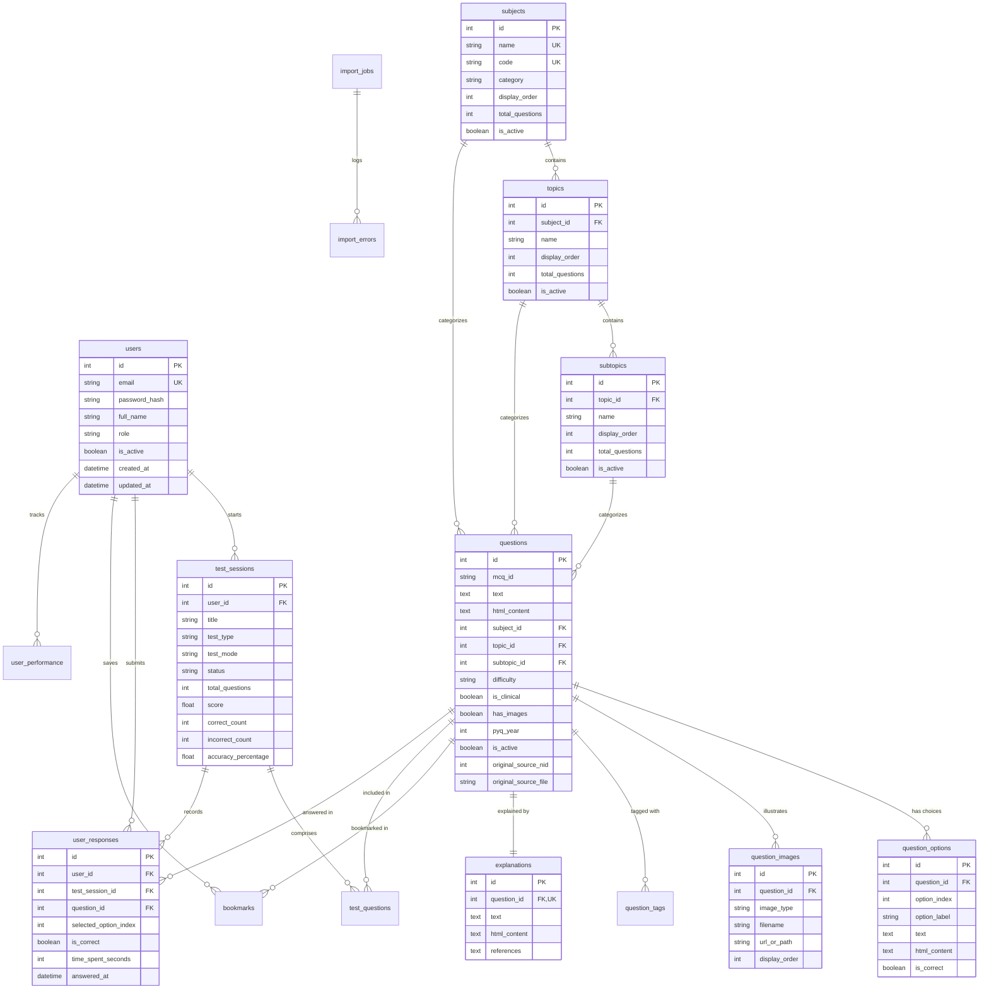

# NEET PG Question Bank Platform - Database Schema & Data Dictionary

## 1. Entity-Relationship Architecture

The relational schema is implemented in PostgreSQL via SQLAlchemy 2.0. It models the medical question hierarchy, answer choices, clinical images, tag taxonomies, student test sessions, and audit logging for 100,000+ medical questions.

---

## 2. Table Dictionaries

### 2.1 `users`
| Column | Type | Constraints | Description |
| :--- | :--- | :--- | :--- |
| `id` | `INTEGER` | `PRIMARY KEY`, Auto | Unique system user ID |
| `email` | `VARCHAR(255)` | `UNIQUE`, `NOT NULL`, Indexed | User email address for authentication |
| `password_hash` | `VARCHAR(255)` | `NOT NULL` | Argon2 / Bcrypt cryptographic hash |
| `full_name` | `VARCHAR(150)` | `NOT NULL` | User full name |
| `role` | `VARCHAR(20)` | `NOT NULL`, Default `student` | Role: `student`, `admin`, `faculty` |
| `is_active` | `BOOLEAN` | `NOT NULL`, Default `true` | Account active state |
| `target_exam_year` | `INTEGER` | Nullable | Year of NEET PG target exam |
| `created_at` / `updated_at` | `TIMESTAMPTZ`| `NOT NULL` | Audit timestamps |

### 2.2 `subjects`
| Column | Type | Constraints | Description |
| :--- | :--- | :--- | :--- |
| `id` | `INTEGER` | `PRIMARY KEY`, Auto | Unique subject ID |
| `name` | `VARCHAR(100)` | `UNIQUE`, `NOT NULL` | E.g., `Medicine`, `Surgery`, `Pathology` |
| `code` | `VARCHAR(20)` | `UNIQUE`, `NOT NULL` | E.g., `MED`, `SURG`, `PATH` |
| `category` | `VARCHAR(30)` | `NOT NULL` | `Pre-clinical`, `Para-clinical`, `Clinical` |
| `display_order` | `INTEGER` | `NOT NULL`, Default 0 | UI sorting order |
| `icon_name` | `VARCHAR(50)` | Nullable | Material icon name for mobile client |
| `total_questions`| `INTEGER` | `NOT NULL`, Default 0 | Denormalized count for instant UI display |
| `is_active` | `BOOLEAN` | `NOT NULL`, Default `true` | Visibility flag |

### 2.3 `topics` & `subtopics`
| Column | Type | Constraints | Description |
| :--- | :--- | :--- | :--- |
| `id` | `INTEGER` | `PRIMARY KEY`, Auto | Primary Key |
| `subject_id` / `topic_id`| `INTEGER` | `FOREIGN KEY`, `NOT NULL`, Indexed | Parent hierarchy foreign key |
| `name` | `VARCHAR(255)` | `NOT NULL`, Indexed | Topic name (e.g., `Cardiology`) |
| `display_order` | `INTEGER` | `NOT NULL`, Default 0 | Sorting order |
| `total_questions`| `INTEGER` | `NOT NULL`, Default 0 | Question count |
| `is_active` | `BOOLEAN` | `NOT NULL`, Default `true` | Visibility flag |

### 2.4 `questions`
| Column | Type | Constraints | Description |
| :--- | :--- | :--- | :--- |
| `id` | `INTEGER` | `PRIMARY KEY`, Auto | Internal primary key |
| `mcq_id` | `VARCHAR(50)` | Nullable, Indexed | External source MCQ ID (e.g. `Q865383`) |
| `text` | `TEXT` | `NOT NULL` | Cleaned plain text for search |
| `html_content` | `TEXT` | `NOT NULL` | Full HTML preserving tables, bold, lists |
| `subject_id` | `INTEGER` | `FOREIGN KEY`, `NOT NULL`, Indexed | References `subjects.id` |
| `topic_id` | `INTEGER` | `FOREIGN KEY`, Nullable, Indexed | References `topics.id` |
| `subtopic_id` | `INTEGER` | `FOREIGN KEY`, Nullable, Indexed | References `subtopics.id` |
| `difficulty` | `VARCHAR(20)` | `NOT NULL`, Default `medium` | `easy`, `medium`, `hard` |
| `is_clinical` | `BOOLEAN` | `NOT NULL`, Default `false` | Vignette / clinical scenario flag |
| `has_images` | `BOOLEAN` | `NOT NULL`, Default `false` | Image-based question flag |
| `is_multiple_correct`| `BOOLEAN` | `NOT NULL`, Default `false` | Single vs multiple choice |
| `pyq_year` | `INTEGER` | Nullable, Indexed | Previous Year Question exam year |
| `original_source_nid`| `INTEGER` | Nullable, Indexed | Original Anki note ID (`nid`) |
| `original_source_file`| `VARCHAR(255)`| Nullable | Source APKG archive filename |
| `is_active` | `BOOLEAN` | `NOT NULL`, Default `true`, Indexed| Active status |

### 2.5 `question_options`
| Column | Type | Constraints | Description |
| :--- | :--- | :--- | :--- |
| `id` | `INTEGER` | `PRIMARY KEY`, Auto | Primary key |
| `question_id` | `INTEGER` | `FOREIGN KEY`, `NOT NULL`, Indexed | References `questions.id` |
| `option_index` | `INTEGER` | `NOT NULL` | 0, 1, 2, 3... (supports 4 to 8 options) |
| `option_label` | `VARCHAR(10)` | `NOT NULL` | `A`, `B`, `C`, `D`, `E`... |
| `text` | `TEXT` | `NOT NULL` | Stripped text |
| `html_content` | `TEXT` | `NOT NULL` | Preserved HTML content |
| `is_correct` | `BOOLEAN` | `NOT NULL`, Default `false` | Correct answer flag |

### 2.6 `question_images`
| Column | Type | Constraints | Description |
| :--- | :--- | :--- | :--- |
| `id` | `INTEGER` | `PRIMARY KEY`, Auto | Primary key |
| `question_id` | `INTEGER` | `FOREIGN KEY`, `NOT NULL`, Indexed | References `questions.id` |
| `image_type` | `VARCHAR(20)` | `NOT NULL` | `question` or `explanation` |
| `filename` | `VARCHAR(255)` | `NOT NULL` | SHA-1 / storage filename |
| `url_or_path` | `VARCHAR(500)` | `NOT NULL` | Relative or CDN URL |
| `original_anki_name`| `VARCHAR(255)`| Nullable | Original filename from Anki media map |
| `display_order`| `INTEGER` | `NOT NULL`, Default 0 | Order of images in question/explanation |

### 2.7 `explanations`
| Column | Type | Constraints | Description |
| :--- | :--- | :--- | :--- |
| `id` | `INTEGER` | `PRIMARY KEY`, Auto | Primary key |
| `question_id` | `INTEGER` | `FOREIGN KEY`, `UNIQUE`, `NOT NULL` | 1-to-1 with `questions.id` |
| `html_content` | `TEXT` | `NOT NULL` | High-yield formatted explanation HTML |
| `text` | `TEXT` | `NOT NULL` | Searchable plain text |
| `references` | `TEXT` | Nullable | Textbook references (Harrison, Robbins, etc.) |

### 2.8 `test_sessions`, `test_questions` & `user_responses`
| Table | Key Columns | Purpose |
| :--- | :--- | :--- |
| `test_sessions` | `id`, `user_id`, `test_type`, `test_mode`, `score`, `accuracy_percentage` | Encapsulates every test attempt (Practice or Exam mode). |
| `test_questions`| `test_session_id`, `question_id`, `question_order`, `is_marked_for_review` | Stores question order and bookmark/review status during a test. |
| `user_responses`| `test_session_id`, `question_id`, `user_id`, `selected_option_index`, `is_correct` | Records student response, time spent in seconds, and correctness. |

### 2.9 `bookmarks` & `user_performance`
| Table | Key Columns | Purpose |
| :--- | :--- | :--- |
| `bookmarks` | `user_id`, `question_id`, `notes` | Student question bookmarking with personal revision notes. |
| `user_performance`| `user_id`, `subject_id`, `topic_id`, `total_attempted`, `accuracy_percentage` | Pre-aggregated Marrow-style analytics cache. |

### 2.10 `import_jobs` & `import_errors`
| Table | Key Columns | Purpose |
| :--- | :--- | :--- |
| `import_jobs` | `id`, `file_path`, `status`, `total_notes_in_source`, `imported_records`, `duplicate_records` | Tracks APKG imports, resumable progress, and field mappings. |
| `import_errors`| `import_job_id`, `source_nid`, `mcq_id`, `error_type`, `error_message` | Audits failed records without failing the entire batch import. |

