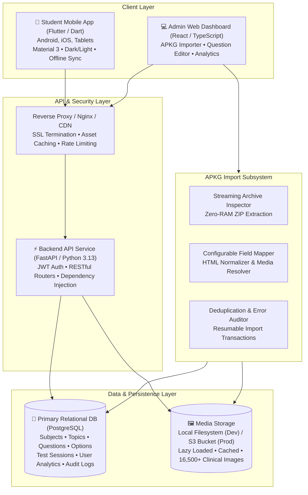
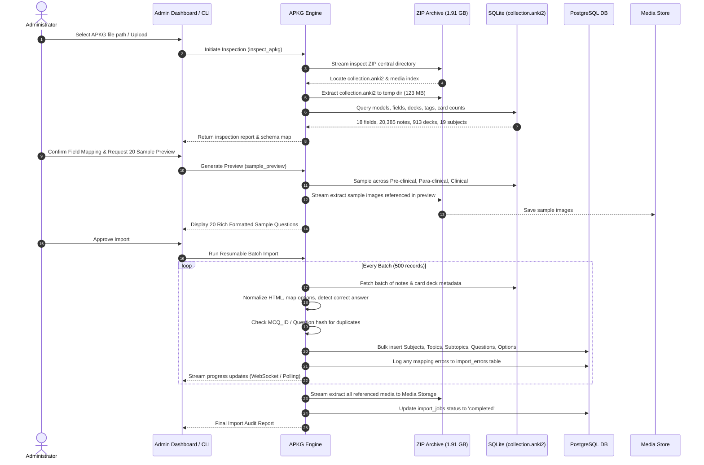

# NEET PG Question Bank Platform - System Architecture

## 1. Architectural Overview & Design Philosophy

The NEET PG Question Bank Platform is an enterprise-grade medical education application designed to deliver a high-performance, distraction-free study experience inspired by Marrow and PrepLadder. The system is engineered to manage **100,000+ medical MCQs**, multi-resolution clinical images, detailed high-yield explanations, custom test sessions, and granular student performance analytics.

### Core Design Principles
1. **Source Authenticity & Zero Hallucination**:
   - Strictly **no RAG, no vector databases, no AI generation/modification** of medical questions.
   - All questions, answer keys, explanations, and medical images originate strictly from verified imported source material (such as the 1.91 GB Anki APKG collection).
2. **Data Integrity & Traceability**:
   - Every question retains its original source file name, source note ID (`nid`), original `MCQ_ID`, and original HTML content.
   - Idempotent import engine prevents duplicate questions while preserving cross-deck references (e.g., Previous Year Questions).
3. **RAM-Efficient Stream Processing**:
   - The 1.91 GB APKG archive containing 16,500+ media files and 20,385+ notes is processed using streaming ZIP readers without loading the archive into RAM.
4. **Sub-100ms Query Latency at Scale**:
   - Paginated API responses, compound B-tree indexes on `(subject_id, topic_id, difficulty)`, and indexed responses for fast test generation and real-time analytics.
5. **Separation of Concerns**:
   - Decoupled API backend (FastAPI), administrative dashboard (React/TS), and cross-platform student client (Flutter/Dart).

---

## 2. Technology Stack

| Layer | Technology | Justification |
| :--- | :--- | :--- |
| **Mobile Client** | **Flutter 3.x / Dart 3.x** | Unified single codebase for Android, iOS, and tablets; pixel-perfect Material 3 theming; smooth 60/120 fps transitions; offline question caching. |
| **Admin Dashboard** | **React 18 / TypeScript / Vite** | Type-safe, component-driven administration interface for question editing, APKG visual mapping, import progress monitoring, and catalog management. |
| **Backend API** | **FastAPI / Python 3.13** | High-performance asynchronous REST APIs, automated OpenAPI documentation, robust Pydantic data validation, lightweight footprint. |
| **ORM & Migrations**| **SQLAlchemy 2.0 / Alembic** | Modern Pythonic type-annotated relational queries, connection pooling, transactional integrity, automated schema migrations. |
| **Primary Database** | **PostgreSQL 16** | Robust ACID relational storage, compound B-Tree indexes, JSONB for flexible import metadata, full-text search (`tsvector`), CTEs for hierarchical subjects/topics. |
| **Media Storage** | **Local FS / AWS S3 Compatible** | Local file storage for low-overhead development; pluggable S3/MinIO driver for production scale media delivery with CDN distribution. |
| **Authentication** | **JWT / OAuth2 + Passlib (Argon2 / Bcrypt)** | Stateless, scalable security with role-based access control (`student`, `admin`, `faculty`). |

---

## 3. Subsystem Architecture

### 3.1 APKG Import Engine Subsystem
The APKG import engine is engineered to handle archives up to several gigabytes with zero risk of Out-Of-Memory (OOM) failures:

#### Key Capabilities:
- **Zero-RAM Footprint**: Only database files (`collection.anki2`) and required media streams are extracted on demand.
- **Configurable Field Mapping**: Maps any note model fields to target Question entities dynamically:
  - `Question` $\rightarrow$ Question Text & HTML
  - `MCQ_ID` $\rightarrow$ Unique External Reference ID
  - `Option1..Option8` $\rightarrow$ Dynamic Option entities (supports 4 to 8 options)
  - `CorrectIndex` / `CorrectOption` $\rightarrow$ Answer index resolution
  - `Explanation` $\rightarrow$ Rich Explanation HTML
  - Deck Hierarchy $\rightarrow$ Automatic Subject $\rightarrow$ Topic $\rightarrow$ Subtopic assignment
- **HTML Sanitization**: Cleans Anki-specific markup (``) while rigorously preserving medical formatting (`<strong>`, `<ul>`, `<li>`, `<table>`, ``, subscript/superscript).
- **Duplicate Detection**: Identifies cross-deck duplicates (such as questions existing in both topic decks and Previous Year Question decks) and associates them without duplicating questions in the question bank.

---

### 3.2 Backend Service & API Layer
Built with FastAPI with modular architecture:
- `backend/app/core/`: Configuration, logging, JWT security, database engine & session dependency.
- `backend/app/models/`: SQLAlchemy 2.0 ORM models.
- `backend/app/schemas/`: Pydantic V2 schemas for strict request/response validation.
- `backend/app/api/v1/`: Versioned API endpoints:
  - `/auth`: User registration, login, token refresh, profile.
  - `/subjects`: 19 NEET PG subjects, topics, subtopics, question counts, user progress.
  - `/questions`: Paginated question retrieval, filtering by subject, topic, difficulty, PYQ year.
  - `/tests`: Test session generation, question serving, answer submission, score calculation.
  - `/bookmarks`: Bookmark toggle, list bookmarked questions with filtering.
  - `/analytics`: User accuracy, weak subject detection, time per question, revision recommendations.
  - `/admin`: Question CRUD, import job trigger, preview, error audit.

---

### 3.3 Student Mobile Application (Flutter)
The mobile frontend is structured using Clean Architecture:
- **Presentation Layer**:
  - Material 3 theme (medical slate/indigo primary palette, accessible typography, high-contrast dark mode).
  - Screens: Home Dashboard, Subject Browser, Topic Detail, MCQ Practice Mode, Timed Test Mode, Result & Review Screen, Bookmarks, Analytics & Weakness Heatmap.
- **State Management**: BLoC / Cubit pattern providing deterministic state transitions, event-driven architecture, and zero UI stuttering.
- **Data & Caching Layer**:
  - `Dio` HTTP client with interceptors for JWT injection and automated token refresh.
  - `cached_network_image` for smooth, lazy-loaded clinical diagrams with disk caching.
  - Local SQLite / Hive for offline test session resilience (preventing loss of answers if network fluctuates).

---

### 3.4 Custom Test Generator Subsystem
The test generator supports high-concurrency custom test creation:
1. **Dynamic Filter Engine**: Selects by Subject(s), Topic(s), Subtopic(s), Question status (`unattempted`, `incorrect`, `bookmarked`, `all`), and Difficulty.
2. **True Randomization**: SQL `ORDER BY RANDOM()` or reservoir sampling avoiding in-memory shuffling.
3. **Strict Deduplication**: Enforces SQL `DISTINCT` on question IDs ensuring zero duplicate questions within a single test session.
4. **Flexible Scoring**: Configurable positive marks (+4 standard) and negative marking (-1 standard or custom).

---

## 4. Performance & Scalability Strategy

1. **Database Indexing**:
   - Compound indexes: `(subject_id, topic_id, is_active)`
   - Foreign key indexes: `test_questions(test_session_id, question_id)`
   - Unique constraints: `user_responses(session_id, question_id)`
   - External reference index: `questions(mcq_id)`, `questions(original_source_nid)`
2. **Pagination & Query Limits**:
   - Cursor-based and keyset pagination for question lists to prevent deep `OFFSET` performance degradation.
   - Default page size: 20-50 records.
3. **Image Optimization**:
   - Local and S3 storage stores images under content-addressed or structured filenames (`/media/images/<hash>.jpg`).
   - Mobile client loads images asynchronously with shimmer placeholders and disk caching.
4. **Atomic Transactions**:
   - Test session completion updates `test_sessions`, `user_responses`, and `user_performance` within a single database transaction.

